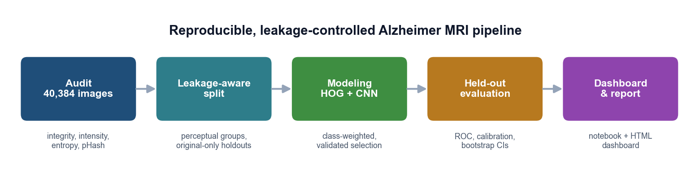
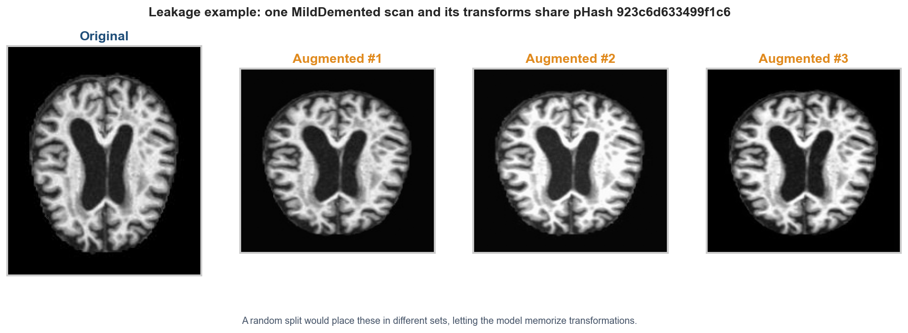
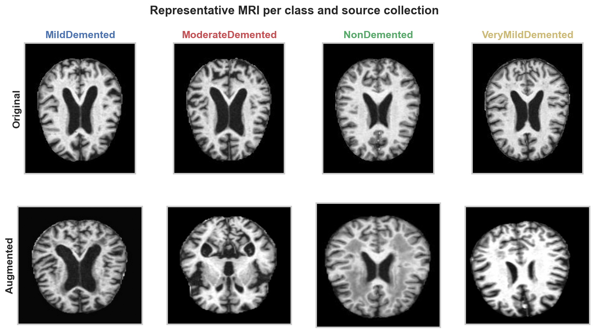
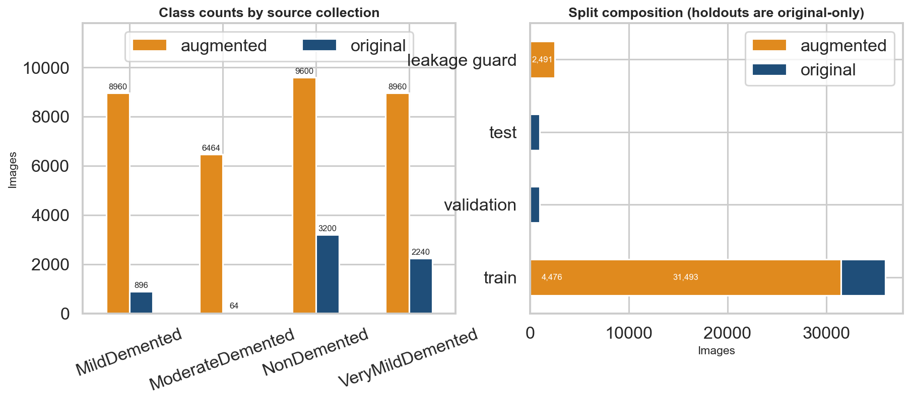
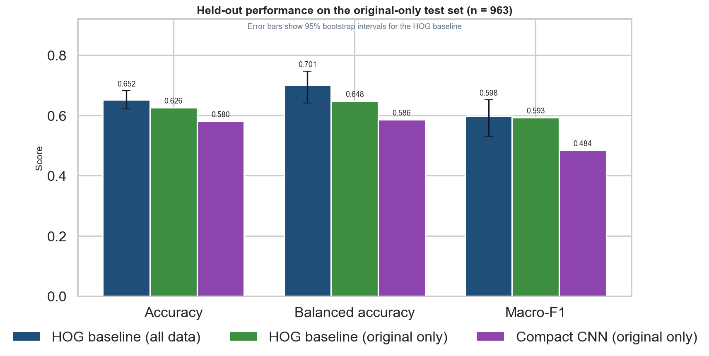
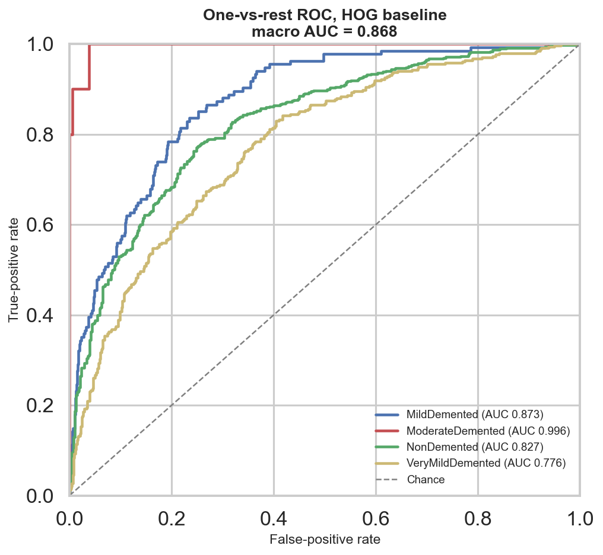
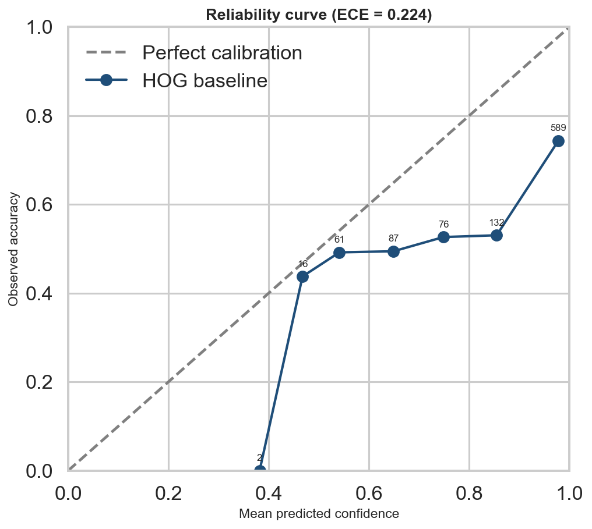
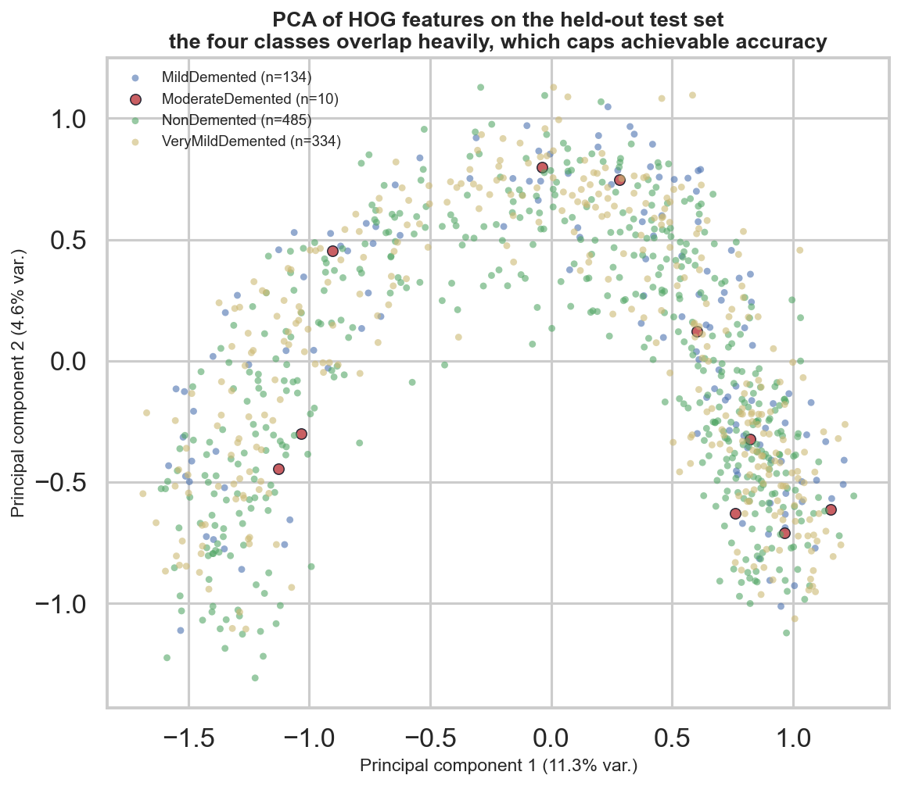
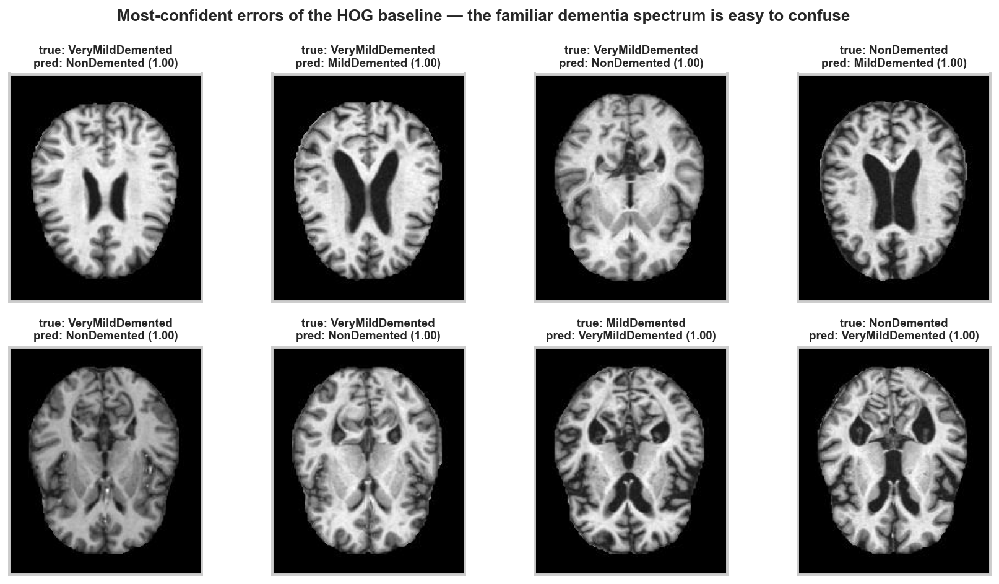
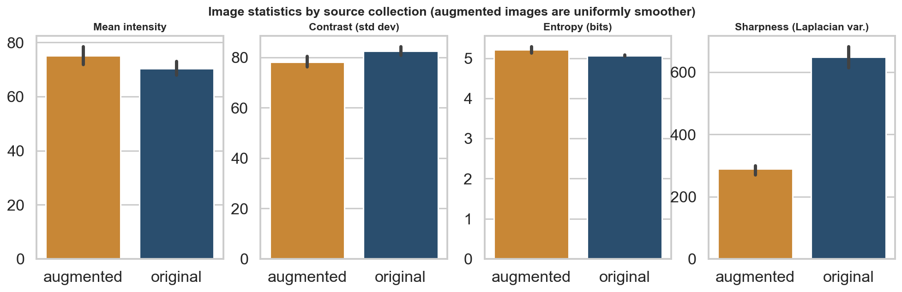

# Alzheimer MRI Classification — Leakage-Aware Pipeline


An **end-to-end, reproducible computer-vision study** that audits 40,384 brain-MRI images,
exposes a **data-leakage trap** in the popular "augmented" Alzheimer dataset, builds
leakage-controlled splits, benchmarks classical and deep models on a clean held-out set, and ships
an interactive **Streamlit** demo — the full workflow of a data analyst → ML/DL engineer.



> Educational research prototype. **Not** a medical diagnostic system.

## At a glance

| | |
|---|---|
| **Task** | 4-class brain-MRI classification (Mild / Moderate / Non / Very-mild demented) |
| **Data** | 40,384 images (6,400 original + 33,984 augmented) |
| **Key finding** | 3,626 perceptual-hash groups leak across source collections |
| **Best model** | HOG + linear — 65.2% accuracy · 0.598 macro-F1 · 0.868 ROC-AUC |
| **Also included** | compact PyTorch CNN, Grad-CAM, Streamlit GUI, HTML dashboard |
| **Stack** | Python, scikit-learn, PyTorch, scikit-image, pandas, Streamlit, Plotly |

| Model | Training data | Accuracy | Balanced acc. | Macro-F1 | ROC-AUC |
|---|---|---:|---:|---:|---:|
| **HOG + linear** | augmented + original | **65.2%** | **70.1%** | **0.598** | **0.868** |
| HOG + linear | original only | 62.6% | 64.8% | 0.593 | 0.831 |
| Compact CNN | original only | 58.0% | 58.6% | 0.484 | 0.851 |

The headline contribution is **honest, leakage-controlled evaluation** — not a leaderboard number.

## Why this project matters

The Kaggle *Augmented Alzheimer MRI* dataset ships an `OriginalDataset` and a much larger
`AugmentedAlzheimerDataset`. Splitting *all* images at random lets augmented copies of the same
underlying scan appear in **both training and test**, inflating scores. The audit found
**3,626 same-label perceptual-hash groups that cross the two collections** — the same scan present
as an original *and* as transformed copies:



This repository fixes that: validation and test are drawn from **original images only**, grouped by
perceptual hash, and every augmented image whose group matches a held-out scan is **quarantined**
(2,491 images) rather than trained on.

## Interactive demo (Streamlit)

A ready-to-run GUI for real-life testing: upload an MRI slice (or pull a random example), choose the
baseline or CNN, and inspect per-class probabilities, a confidence/review flag, and a Grad-CAM
saliency map.

```bash
pip install -r requirements.txt
streamlit run app.py
```

The app opens at `http://localhost:8501`. It also exposes the held-out metrics, data-quality
audit, and methodological caveats in dedicated tabs.

## Dataset

- Source: [Augmented Alzheimer MRI Dataset](https://www.kaggle.com/datasets/uraninjo/augmented-alzheimer-mri-dataset) (Kaggle).
- Four classes: `MildDemented`, `ModerateDemented`, `NonDemented`, `VeryMildDemented`.
- 40,384 images total; strongly imbalanced (original counts 896 / **64** / 3,200 / 2,240).
- Images are **not committed** (downloadable and large); see [docs/DATA_CARD.md](docs/DATA_CARD.md).




## Methodology

`Audit → Leakage-aware split → Modeling → Held-out evaluation → Dashboard & app`

| Stage | Module | Output |
|---|---|---|
| Audit | `alzheimer_mri.audit` | integrity, statistics, SHA-256, DCT perceptual hashes |
| Split | `alzheimer_mri.splits` | original-only holdouts + augmented quarantine guard |
| Baseline | `alzheimer_mri.baseline` | HOG + intensity histogram → class-balanced linear model |
| CNN | `alzheimer_mri.train` / `evaluate` | compact PyTorch CNN, class-weighted loss, early stopping |
| Explain | `alzheimer_mri.explain` | Grad-CAM saliency |
| Serve | `alzheimer_mri.predict` | batch inference with low-confidence flags |

Full details in [docs/METHODOLOGY.md](docs/METHODOLOGY.md) and [reports/PROJECT_REPORT.md](reports/PROJECT_REPORT.md).

## Results in depth

The HOG baseline reaches **ROC-AUC 0.868**; per-class AUC ranges from 0.776 (VeryMild) to 0.996
(Moderate). Bootstrap 95% intervals: accuracy [0.622, 0.682], macro-F1 [0.530, 0.652]. The CNN is
better **calibrated** (ECE 0.140 vs 0.224) despite lower accuracy.



| ROC (ranking quality) | Reliability (calibration) |
|---|---|
|  |  |

### Why accuracy is capped

The four classes overlap heavily in feature space — the dementia spectrum is genuinely continuous,
so even the highest-confidence errors are visually plausible:

| HOG feature space (PCA) | Most-confident errors |
|---|---|
|  |  |

Augmented images are also systematically **smoother** (mean Laplacian variance ~300 vs ~650), a
source cue a naive model could exploit:



## Project structure

```text
alzheimer-mri-classification/
├── app.py                    # Streamlit GUI for real-life testing
├── src/alzheimer_mri/        # installable package (audit, splits, baseline, cnn, evaluate, predict...)
├── notebooks/                # executed analysis notebook (data quality + model results)
├── scripts/                  # pipeline runner + figure/notebook/dashboard builders
├── configs/                  # CPU CNN configuration
├── docs/                     # DATA_CARD, METHODOLOGY, MODEL_CARD, figures/
├── reports/                  # DATA_QUALITY_REPORT, PROJECT_REPORT
├── dashboard/                # self-contained interactive dashboard (index.html)
├── results/                  # metrics, reports, figures (committed evidence)
├── tests/                    # unit tests + GitHub Actions CI
├── .streamlit/config.toml    # app theme
├── requirements.txt
└── pyproject.toml
```

## Setup

```bash
git clone https://github.com/imahrous13/alzheimer-mri-classification.git
cd alzheimer-mri-classification
python -m venv .venv
# Windows: .venv\Scripts\activate   |   macOS/Linux: source .venv/bin/activate
pip install -r requirements.txt
```

## Reproduce everything

```bash
# download the dataset first (optional helper):
#   kaggle datasets download -d uraninjo/augmented-alzheimer-mri-dataset
#   place class folders at data/raw/original/<Class>/ and data/raw/augmented/<Class>/

./scripts/run_pipeline.ps1        # Windows
./scripts/run_pipeline.sh         # macOS/Linux
```

This runs the audit, splits, both baselines, CNN training + evaluation, metric enrichment, the
executed notebook, the figure gallery, and the dashboard.

Score a single scan from the command line:

```bash
python -m alzheimer_mri.predict_baseline path/to/scan.jpg --output prediction.csv
python -m alzheimer_mri.predict          path/to/scan.jpg --output cnn_prediction.csv
```

## Documentation

- [Data card](docs/DATA_CARD.md) · [Methodology](docs/METHODOLOGY.md) · [Model card](docs/MODEL_CARD.md)
- [Data-quality report](reports/DATA_QUALITY_REPORT.md) · [Project report](reports/PROJECT_REPORT.md)
- Interactive [dashboard](dashboard/index.html) · executed [notebook](notebooks/alzheimer_mri_audit_and_results.ipynb)
- Where to place the dataset: [data/README.md](data/README.md)

## Development

```bash
pip install -r requirements-dev.txt   # runtime + notebook + lint/test tooling
make help        # list targets
make test        # 15 unit tests (incl. a Streamlit app smoke test)
make lint        # ruff (configured in pyproject.toml)
make figures     # regenerate docs/figures
make dashboard   # rebuild dashboard/index.html
make app         # launch the Streamlit demo
```

CI (GitHub Actions) runs ruff, a compile check, and the test suite on Python 3.10 and 3.11.

## Limitations & ethics

- No patient identifiers: perceptual grouping blocks image-copy leakage but cannot guarantee
  patient-independent splitting.
- `ModerateDemented` has only 64 original images (test n = 10) → its metrics are preliminary.
- Single dataset; no external cohort, scanner metadata, calibration study, or clinical review.
- The from-scratch CNN is data/compute-limited on CPU (a reference point, not tuned).

**Do not** use these outputs for diagnosis or any patient-facing decision.

## License

Released under the [MIT License](LICENSE).
